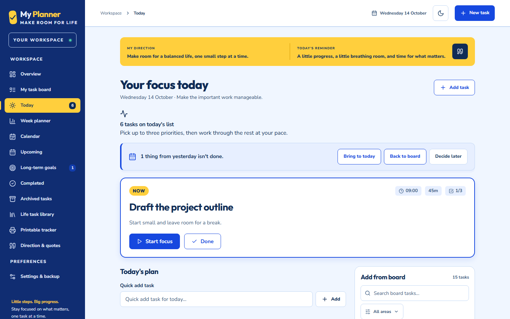

# My Planner

Make room for life.

My Planner is a free, ADHD-friendly, local-first planner for adults. Bring daily tasks, longer-term goals and the rest of life into one workspace, with no account or backend required. Built with React, TypeScript and Vite.

## Features

- **Today:** a Now card, daily timeline and focus mode with a timer to help you work on one thing at a time.
- **Task board:** organise tasks with drag and drop, priorities, progress states, duplication and archiving.
- **Week planner:** plan tasks for the week and copy them to selected days.
- **Calendar day planning:** build and reorder a day's plan alongside recurring task occurrences.
- **Recurrence and checklists:** repeat routines and break tasks into smaller steps.
- **Quick add:** capture a task without opening the full editor.
- **Life task library:** 64 optional templates, including a starter set of 12.
- **Areas and goals:** customise areas of life and keep longer-term goals visible.
- **Direction and quotes:** original encouragement, daily selections and your own quotes.
- **Printable PDF tracker:** day, week, month and year sheets, with A4/A3 landscape export and optional checklists.
- **JSON backups:** export and restore your tasks, plans, history, areas and settings.
- **Getting started:** optional onboarding and an optional weekly score, with commitments and reviews.
- **Accessible, responsive interface:** keyboard navigation, focus indicators, light/dark themes and layouts for smaller screens.

## Privacy and your data

Your planner data stays in this browser's localStorage. There are no accounts, cloud sync or server backups. The storage key remains `my-command-centre:v1` so existing saved boards continue to load.

Each browser profile and site address has separate storage. Changing the hostname, port or deployment address will show a separate board. Clearing site data or losing the browser profile can remove your planner; private browsing may discard it when the session ends. Local-first storage does not mean the site is guaranteed to load offline.

To back up:

1. Open **Settings & backup** and choose **Download backup**.
2. Save the downloaded `my-planner-YYYY-MM-DD.backup.json` file somewhere safe, ideally outside this device. Keep previous copies.
3. To restore or transfer your planner, open **Settings & backup → Import backup**, select the JSON file and review the confirmation. Import replaces the current board; download a backup of that board first.

Older My Tasker / `my-tasker` backups still import: the JSON format is unchanged and filenames do not determine compatibility. Recovery screens, import validation and cross-tab conflict handling help protect data, but recovery copies in the same browser are not a substitute for downloaded backups. Backup files contain your planner data; share them only intentionally. PDFs are printable snapshots and cannot be imported as backups.

## Run locally

Use Node.js 20.19+ and npm. From the repository root:

```sh
npm ci
npm run dev
```

Open **http://127.0.0.1:5180/**. The development server uses port **5180** with strict port checking. Keep using the same address and browser profile to access the same data. On Windows, after installing dependencies, you can also use the existing `Start-My-Tasker.cmd` launcher.

## Build

```sh
npm run build
npm run preview
```

The build checks TypeScript and creates the static site in `dist/`. Preview serves it at **http://127.0.0.1:5180/**; stop the development server first if it is using that port.

## Test

```sh
npm test
```

For browser tests, install Chromium once, then run Playwright:

```sh
npx playwright install chromium
npm run test:e2e
```

Playwright starts its own server at **http://127.0.0.1:5181/**. Leave port **5181** free. Its test browser uses separate storage from your everyday planner on port 5180.

## Deploy

Deploy this repository as a static site on Netlify or Vercel, using the repository root as the project directory:

| Platform | Existing configuration | Build command | Publish/output directory |
| --- | --- | --- | --- |
| Netlify | [netlify.toml](netlify.toml) | `npm run build` | `dist` |
| Vercel | [vercel.json](vercel.json) | `npm run build` | `dist` |

Both configurations match the local build. Netlify includes a fallback to `index.html`; Vercel identifies the project as Vite. No backend or environment secrets are required. Export a JSON backup before switching site addresses, then import it at the new address to transfer your planner.

## Screenshots

Screenshots use a neutral demo board with fictional tasks. Desktop captures are 1440×900; mobile is 390×844.



| View | Screenshot |
| --- | --- |
| Today on mobile | [today-mobile.png](docs/screenshots/today-mobile.png) |
| Today in dark theme | [today-dark.png](docs/screenshots/today-dark.png) |
| Focus mode | [focus.png](docs/screenshots/focus.png) |
| Task board | [board.png](docs/screenshots/board.png) |
| Week planner | [week.png](docs/screenshots/week.png) |
| Calendar | [calendar.png](docs/screenshots/calendar.png) |
| Calendar day planning window | [calendar-day.png](docs/screenshots/calendar-day.png) |
| Printable tracker | [tracker.png](docs/screenshots/tracker.png) |
| Settings & backup | [settings.png](docs/screenshots/settings.png) |

To regenerate from the repository root (normal test runs skip this spec):

```sh
CAPTURE_SCREENSHOTS=1 npx playwright test tests/readme-screenshots.spec.ts
```

In PowerShell, use `$env:CAPTURE_SCREENSHOTS='1'; npx.cmd playwright test tests/readme-screenshots.spec.ts`, then `Remove-Item Env:CAPTURE_SCREENSHOTS` before running normal tests.

## Project history

Originally extracted from [ChemistTasker PR #180](https://github.com/chemisttasker11-ezy/ChemistTasker-Ezy1/pull/180). This repository is a standalone browser app. See [CHANGELOG.md](CHANGELOG.md) for release notes. The retained `preview.html` is an earlier static mock-up; the running React app is the current interface.
